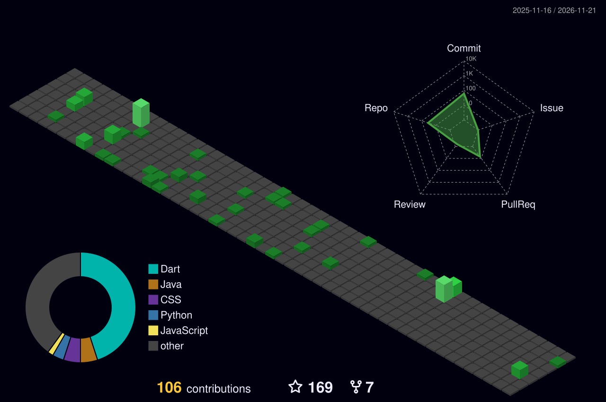

<!-- ═══════════════════════════════════════════════════════════════════════════
     ABHISHEK MAHESHWARI — GitHub Profile README
     Designed for 2026 AI Era · Modern 3D · Multi-Persona Appeal
     ═══════════════════════════════════════════════════════════════════════════ -->

<div align="center">

<!-- ░░░░░░░░░░░░░░░░░░░░░  ANIMATED HEADER BANNER  ░░░░░░░░░░░░░░░░░░░░░░░░ -->


<!-- ░░░░░░░░░░░░░░░░░░░░░  ANIMATED TYPING ROLES  ░░░░░░░░░░░░░░░░░░░░░░░░░ -->

[](https://git.io/typing-svg)

<br/>

<!-- ░░░░░░░░░░░░░░░░░░░░  SOCIAL PROOF BADGES  ░░░░░░░░░░░░░░░░░░░░░░░░░░░░ -->

[](https://github.com/Abhishek-Maheshwari-778)
[](https://github.com/Abhishek-Maheshwari-778?tab=followers)
[](https://github.com/Abhishek-Maheshwari-778?tab=repositories)
[](https://linkedin.com/in/abhishekmaheshwari2436)

</div>

---

<!-- ░░░░░░░░░░░░░░░░░░░░░░░░  WHO AM I — IDENTITY CARD  ░░░░░░░░░░░░░░░░░░░ -->

<table align="center" width="98%">
<tr>
<td width="55%" valign="top">

## 🧑‍💻 Who Am I?

```yaml
name        : Abhishek Maheshwari
location    : Bilsi, Badaun, Uttar Pradesh, India
education   : BCA — Invertis University (2023–2026)
              CGPA: 7.6 / 10

current_role: Computer Science Teacher
              Bhoo Devi Varshney Inter College
              (Full-time | Jul 2026 – Present)

passion     :
  - Building AI-powered tools & apps
  - IoT / Robotics / Embedded Systems
  - Teaching & Mentoring Tech Students
  - Data Analytics & Visualization
  - Android & Windows App Development

superpower  : Turning hardware + software + data
              into real-world impact 🚀
```

</td>
<td width="45%" valign="top" align="center">

## 📊 GitHub At a Glance


</td>
</tr>
</table>

---

<!-- ░░░░░░░░░░░░░░░░░░░░░░░  3D CONTRIBUTION GRAPH  ░░░░░░░░░░░░░░░░░░░░░░░ -->

<div align="center">

## 🌐 3D Contribution Landscape

> *Auto-generated daily via GitHub Actions — real commits, real grind* 💪

<picture>
  <source media="(prefers-color-scheme: dark)" srcset="https://raw.githubusercontent.com/Abhishek-Maheshwari-778/Abhishek-Maheshwari-778/main/profile-3d-contrib/profile-night-green.svg" />
  <source media="(prefers-color-scheme: light)" srcset="https://raw.githubusercontent.com/Abhishek-Maheshwari-778/Abhishek-Maheshwari-778/main/profile-3d-contrib/profile-south-season-animate.svg" />
  
</picture>

</div>

---

<!-- ░░░░░░░░░░░░░░░░░░░░░░  MULTI-DOMAIN EXPERTISE  ░░░░░░░░░░░░░░░░░░░░░░░ -->

<div align="center">

## ⚡ Tech Stack — Full Spectrum

</div>

<table align="center" width="98%">
<tr>
<td align="center" width="25%">

### 🤖 AI & Machine Learning


</td>
<td align="center" width="25%">

### 📊 Data & Analytics


</td>
<td align="center" width="25%">

### 🛸 IoT & Robotics


</td>
<td align="center" width="25%">

### 📱 App & Dev Tools


</td>
</tr>
</table>

<div align="center">

</div>

---

<!-- ░░░░░░░░░░░░░░░░░░░░░  EXPERIENCE TIMELINE  ░░░░░░░░░░░░░░░░░░░░░░░░░░░ -->

## 💼 Experience & Journey

```
  2026 ━━━━━━━━━━━━━━━━━━━━━━━━━━━━━━━━━━━━━━━━━━━━━━━━━━━━━━━━━━━━━━━━━━━━
  🏫  COMPUTER SCIENCE TEACHER                         [Jul 2026 – Present]
      Bhoo Devi Varshney Inter College · Full-time · On-site
      ✦ Teaching CS & IT fundamentals to secondary/higher-secondary students
      ✦ Conducting hands-on computer lab sessions for coding & software
      ✦ Mentoring students in problem-solving, logical reasoning & tech skills
      ✦ Integrating interactive tools and AI-powered resources into lessons
      ✦ Assessing student progress with structured evaluation frameworks
  ───────────────────────────────────────────────────────────────────────────
  2025 ━━━━━━━━━━━━━━━━━━━━━━━━━━━━━━━━━━━━━━━━━━━━━━━━━━━━━━━━━━━━━━━━━━━━
  🤖  INDUSTRIAL AUTOMATION VIRTUAL INTERN             [Oct – Dec 2025]
      EduSkills Foundation (AICTE) · Remote · Govt. of India Certified
      ✦ 10-week AICTE program under National Internship Portal, MoE
      ✦ PLC programming, control systems, IoT integration
      ✦ Industrial sensors, actuators & automation scripting
  ───────────────────────────────────────────────────────────────────────────
  ☁️  GOOGLE DATA ANALYTICS VIRTUAL INTERN             [Apr – Jun 2025]
      EduSkills / Google Cloud · Remote
      ✦ Queried large datasets using BigQuery & Looker Studio
      ✦ Data storytelling, dashboard creation & insight generation
  ───────────────────────────────────────────────────────────────────────────
  2024 ━━━━━━━━━━━━━━━━━━━━━━━━━━━━━━━━━━━━━━━━━━━━━━━━━━━━━━━━━━━━━━━━━━━━
  📊  DATA SCIENCE & ANALYTICS INTERN                  [Jun – Aug 2024]
      Zidio Development · Remote
      ✦ Applied Python, Pandas, NumPy in real-world data projects
      ✦ Strengthened analytical thinking & visualization skills
  ───────────────────────────────────────────────────────────────────────────
  🐍  PYTHON PROGRAMMING INTERN                        [Aug – Sep 2024]
      CodeAlpha · Remote
      ✦ Built Python apps: Hangman Game, Chatbot, Automation Scripts
      ✦ Strengthened logic building & modular coding practices
  ───────────────────────────────────────────────────────────────────────────
  🎪  TECHNICAL EVENT ORGANIZER                        [2024 – 2025]
      Technova Fest · BCA Dept., Invertis University
      ✦ Organized C Combat, HackerRank challenges, Office Essentials events
      ✦ Managed lab coordination, scheduling & participant flow
  ───────────────────────────────────────────────────────────────────────────
```

---

<!-- ░░░░░░░░░░░░░░░░░░░░░░░░  FEATURED PROJECTS  ░░░░░░░░░░░░░░░░░░░░░░░░░░ -->

## 🚀 Featured Projects

<!-- ── DATA & ANALYTICS ── -->
### 📊 Data & Analytics Projects

<table align="center" width="98%">
<tr>
<td width="50%" valign="top">

**📊 SuperStore Sales Power BI Dashboard**
> Interactive business intelligence dashboard with real-time KPI tracking

- 🛠️ `Power BI` · `DAX` · `Data Modeling`
- 📌 Sales, profits, discounts & shipping trends across regions
- 📌 DAX formulas for Total Sales, Profit Margins, Top Categories
- 📌 Multi-page interactive visual report

[](https://github.com/Abhishek-Maheshwari-778/SuperStore_Sales_PowerBI)

</td>
<td width="50%" valign="top">

**🛍️ Vrinda Store Excel Dashboard**
> End-to-end sales analytics dashboard built in Excel

- 🛠️ `Excel` · `Pivot Tables` · `VLOOKUP` · `Charts`
- 📌 Monthly sales, profits & top-performing product tracking
- 📌 Conditional formatting & dynamic chart visuals
- 📌 Business-ready reporting for stakeholders

[](https://github.com/Abhishek-Maheshwari-778/Vrinda_Store_Report_Using_Excel)

</td>
</tr>
<tr>
<td width="50%" valign="top">

**🍕 Pizza Sales Data Analysis — SQL**
> Deep-dive SQL analysis to uncover business insights from sales data

- 🛠️ `MySQL` · `JOINs` · `CTEs` · `Aggregate Functions`
- 📌 Peak order times, top-selling pizzas & customer preferences
- 📌 Meaningful KPIs extracted for business decision-making
- 📌 Complex multi-table query design

[](https://github.com/Abhishek-Maheshwari-778/Pizza_Sales_Data_Analysis_Using_SQL)

</td>
<td width="50%" valign="top">

**🐍 Retail Sales Analysis — Python**
> Large-scale retail dataset analysis with Python data science stack

- 🛠️ `Python` · `Pandas` · `NumPy` · `Matplotlib` · `Seaborn`
- 📌 Data cleaning, transformation & exploratory data analysis
- 📌 Regional performance & product category breakdowns
- 📌 Strategic insights for retail decision-making

[](https://github.com/Abhishek-Maheshwari-778/Retail_Sales_Analysis_Project)

</td>
</tr>
</table>

---

<!-- ── IoT & ROBOTICS ── -->
### 🤖 IoT & Robotics Projects

<table align="center" width="98%">
<tr>
<td width="33%" valign="top">

**🏎️ Monster Car — Robotics**
> 🥉 **3rd Place — Robo Rumble, Invertia 2024**

- 🛠️ `Arduino` · `L298N` · `Embedded C`
- 📌 Wireless-controlled robotic car
- 📌 Obstacle handling & motion control
- 📌 Competition-winning design

</td>
<td width="33%" valign="top">

**🏠 Smart Home Automation**
> Real-world IoT home automation system

- 🛠️ `Arduino` · `LDR` · `DHT11` · `Relay`
- 📌 Auto-controls appliances via sensor data
- 📌 Light, temperature & humidity detection
- 📌 Relay-based switching logic

</td>
<td width="33%" valign="top">

**🔐 Smart Locker Security**
> Keypad-based access control system

- 🛠️ `Arduino` · `Keypad` · `Servo Motor`
- 📌 Password-protected physical lock
- 📌 Servo actuation on correct input
- 📌 Input-output logic & control systems

</td>
</tr>
</table>

---

<!-- ── PYTHON & AI ── -->
### 🧠 Python & AI Projects

<table align="center" width="98%">
<tr>
<td width="50%" valign="top">

**🤖 AI Chatbot — Python**
> Conversational chatbot with NLP logic

- 🛠️ `Python` · `NLP` · `Logic Building`
- 📌 Built during CodeAlpha internship
- 📌 Rule-based response system
- 📌 Modular, extensible architecture

</td>
<td width="50%" valign="top">

**🎮 Hangman Game + Automation Scripts**
> Python mini-apps from CodeAlpha internship

- 🛠️ `Python` · `Logic Building` · `Automation`
- 📌 Classic Hangman with word bank
- 📌 Automation scripts for repetitive tasks
- 📌 Clean, well-commented code

</td>
</tr>
</table>

<div align="center">

[](https://github.com/Abhishek-Maheshwari-778?tab=repositories)

</div>

---

<!-- ░░░░░░░░░░░░░░░░░░░░░░░  GITHUB STATS GRID  ░░░░░░░░░░░░░░░░░░░░░░░░░░░ -->

<div align="center">

## 📈 GitHub Analytics


&nbsp;&nbsp;


</div>

---

<!-- ░░░░░░░░░░░░░░░░░░░░░░░░  CERTIFICATIONS  ░░░░░░░░░░░░░░░░░░░░░░░░░░░░░ -->

## 🏅 Certifications & Credentials

<div align="center">

| 🎖️ Certification | 🏛️ Issuer | 📅 Year |
|:---|:---|:---:|
| 🏭 AICTE Industrial Automation Internship | EduSkills Foundation / AICTE, MoE | 2025 |
| ☁️ Google Data Analytics Certificate | Google Cloud / EduSkills | 2024–25 |
| 📊 Data Analysis with Python | IBM | 2024 |
| 📉 Data Visualization with Python | IBM | 2024 |
| 🐍 Python Intermediate | Sololearn | 2024 |
| 🗄️ Python MySQL | Great Learning | 2024 |

</div>

---

<!-- ░░░░░░░░░░░░░░░░░░░░░░░  AI ERA SKILLS 2026  ░░░░░░░░░░░░░░░░░░░░░░░░░░ -->

## 🧠 AI-Era Skills — 2026 Edition

<div align="center">

```
╔══════════════════════════════════════════════════════════════════════════╗
║                     🤖 WHAT I CAN BUILD WITH AI                        ║
╠══════════════════════════════════════════════════════════════════════════╣
║  📱 Android Apps         — AI-powered mobile apps using Gemini API      ║
║  🖥️ Windows Apps         — Desktop automation tools & productivity apps  ║
║  🤖 AI Chatbots          — Custom bots using LLMs & prompt engineering   ║
║  📊 Intelligent Dashboards — ML-enhanced Power BI & data reports         ║
║  🛸 Smart IoT Systems    — Arduino + AI edge intelligence & automation   ║
║  🏫 EdTech AI Tools      — Personalized learning, quiz generators,       ║
║                            student progress analytics, AI-graded tests   ║
║  🔄 Automation Scripts   — Workflow automation with Python + AI APIs     ║
║  🧩 RAG Systems          — Retrieval-augmented generation pipelines      ║
║  🧠 AI Prompt Engineering— Designing effective prompts for GPT/Gemini    ║
║  🗣️ Voice Assistants     — Python + speech recognition + TTS integration ║
║  📡 IoT + Cloud          — Sensor data → Cloud → AI insight pipelines    ║
║  🎓 AI Curriculum Design — Designing AI & coding lessons for school labs  ║
╚══════════════════════════════════════════════════════════════════════════╝
```

</div>

---

<!-- ░░░░░░░░░░░░░░░░░░░░░░  WHO CAN CONNECT WITH ME  ░░░░░░░░░░░░░░░░░░░░░░ -->

## 🤝 Whether You're a...

<table align="center" width="98%">
<tr>
<td align="center" width="16%">

**🏢 Entrepreneur**
<br/>I turn ideas into working MVPs — apps, dashboards, automation tools, IoT prototypes.

</td>
<td align="center" width="16%">

**👔 Business Executive**
<br/>I make data speak — Power BI, SQL insights, Excel dashboards that drive decisions.

</td>
<td align="center" width="16%">

**💼 HR / Recruiter**
<br/>3 internships, AICTE certification, 55+ repos, teaching experience, real project portfolio.

</td>
<td align="center" width="16%">

**🔬 DRDO / Defense**
<br/>Robotics + embedded systems + IoT + automation — robotics competition winner, sensor expertise.

</td>
<td align="center" width="16%">

**🎓 IIT / Research**
<br/>Arduino projects, PLC, Python ML, data analysis — solid CS fundamentals + hardware skills.

</td>
<td align="center" width="16%">

**🧑‍💻 Tech Professional**
<br/>Python · SQL · Power BI · IoT · AI/ML · Android · Git — full-spectrum modern stack.

</td>
</tr>
</table>

<div align="center">

### ...I've got something to offer you. Let's connect! 👇

</div>

---

<!-- ░░░░░░░░░░░░░░░░░░░░░░░░░  EDUCATION  ░░░░░░░░░░░░░░░░░░░░░░░░░░░░░░░░░ -->

## 🎓 Education

<div align="center">

| 🏫 Institution | 📚 Degree / Level | 📅 Year | 🏆 Score |
|:---|:---|:---:|:---:|
| **Invertis University, Bareilly** | BCA — Bachelor of Computer Applications | 2023–2026 | 7.6 CGPA |
| **Baba International School** | Class XII | 2023 | — |
| **Baba International School** | Class X | 2021 | — |

</div>

---

<!-- ░░░░░░░░░░░░░░░░░░░░░░░░  ACHIEVEMENTS  ░░░░░░░░░░░░░░░░░░░░░░░░░░░░░░░ -->

## 🏆 Achievements & Recognition

<div align="center">

```
🥉  3rd Position — Robo Rumble, Invertia 2024 (Monster Car Robotics Project)
🎪  Organizing Committee Member — Technova Fest 2024–25
🎓  AICTE-Certified National Internship (Ministry of Education, Govt. of India)
☁️  Google Cloud Data Analytics Certified
🏫  Active Member — Abhiruchi Club, Invertis University (2023–24)
👨‍🏫  CS & IT Educator — Teaching & Mentoring 2026 Batch Students
```

</div>

---

<!-- ░░░░░░░░░░░░░░░░░░░░  GITHUB ACTIONS: 3D GRAPH  ░░░░░░░░░░░░░░░░░░░░░░░ -->

## ⚙️ Auto-Updating 3D Graph Setup

> Add this workflow file to `.github/workflows/profile-3d.yml` in your profile repo to auto-generate the 3D contribution graph above:

```yaml
name: GitHub-Profile-3D-Contrib
on:
  schedule:
    - cron: "0 18 * * *"   # Runs every day at 18:00 UTC
  workflow_dispatch:        # Trigger manually from Actions tab
permissions:
  contents: write
jobs:
  build:
    runs-on: ubuntu-latest
    name: generate-github-profile-3d-contrib
    steps:
      - uses: actions/checkout@v4
      - uses: yoshi389111/github-profile-3d-contrib@latest
        env:
          GITHUB_TOKEN: ${{ secrets.GITHUB_TOKEN }}
          USERNAME: ${{ github.repository_owner }}
      - name: Commit & Push
        run: |
          git config user.name github-actions
          git config user.email github-actions@github.com
          git add -A .
          git commit -m "🤖 Auto: Generated 3D Contribution Graph" || exit 0
          git push
```

---

<!-- ░░░░░░░░░░░░░░░░░░░░░░░░  CONNECT SECTION  ░░░░░░░░░░░░░░░░░░░░░░░░░░░░ -->

## 📡 Let's Connect

<div align="center">

[](https://linkedin.com/in/abhishekmaheshwari2436)
[](mailto:abhishekmaheshwari2426@gmail.com)
[](https://github.com/Abhishek-Maheshwari-778)
[](tel:+919837067092)

<br/>

> 🌍 **Location:** Bilsi, Badaun, Uttar Pradesh, India — Open to Remote Opportunities

</div>

---

<!-- ░░░░░░░░░░░░░░░░░░░░░░░░  ACTIVITY GRAPH  ░░░░░░░░░░░░░░░░░░░░░░░░░░░░░ -->

<div align="center">

## 📉 Contribution Activity


</div>

---

<!-- ░░░░░░░░░░░░░░░░░░░░░░░░  FOOTER BANNER  ░░░░░░░░░░░░░░░░░░░░░░░░░░░░░░ -->

<div align="center">


<sub>🤖 <i>README auto-updated · Built with ❤️ in India · 2026 AI Era</i></sub>

</div>

